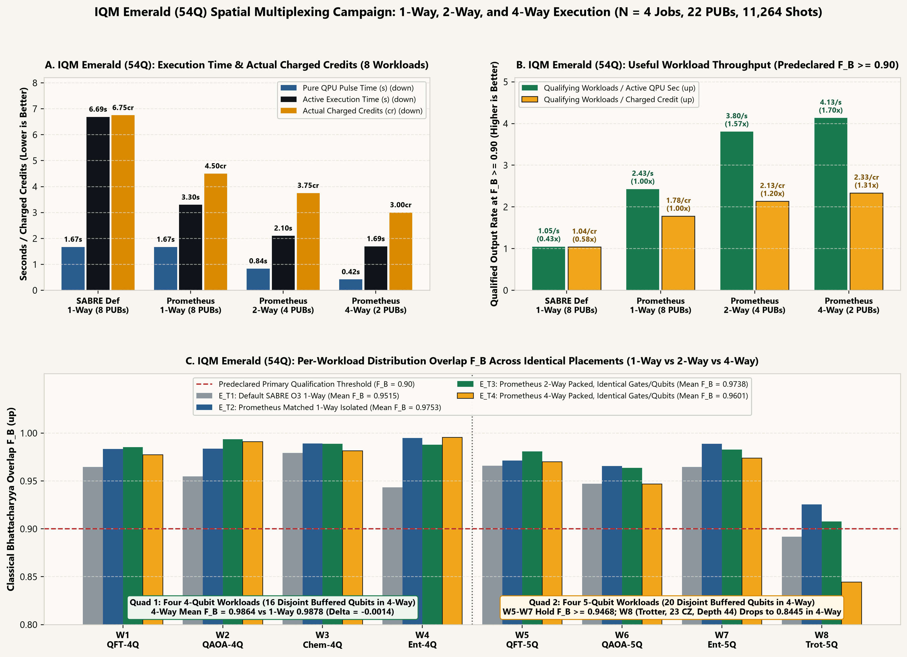
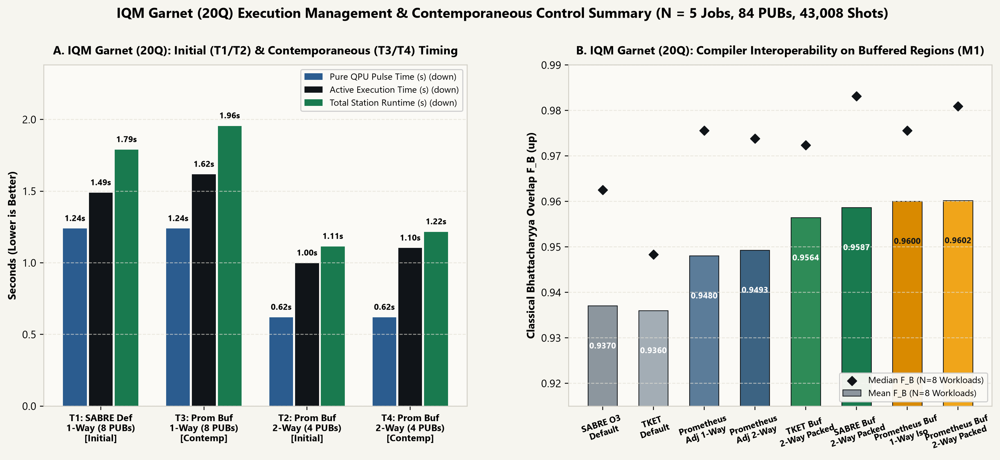

# Detailed Technical Report & Supporting Ledgers: `prometheus-iqm-execution`

*Companion technical report to [`README.md`](README.md) · Part of the [Prometheus quantum execution portfolio](https://github.com/PrometheusDynamicsCanada/prometheus-quantum-overview)*

---

## 2. Dense-Circuit Optimization: Odd/Even Parity, Families & Execution Manager (IQM Emerald 54Q)

All 19 dense-circuit jobs (739 physical circuits, 756,736 shots at 1,024 shots/circuit, 297.00 credits) executed on IQM Emerald (`Calibration Set b06b7ced-9412-49a0-97d0-52218c2e4132`) with every workload's candidate compilers packed inside the same QPU job and randomly permuted.

### 2.1 Odd vs. Even Width Parity Breakdown (7Q-12Q, N = 8 Unique Workloads per Width)

| Width & Parity | Logical Pairs n(n-1)/2 | Workloads (N) | `P2b_TKET_Pure_K8` CZ/Int \| 2Q Depth \| F_B *(mean / med)* | `P3_SABRE_K8` CZ/Int \| 2Q Depth \| F_B *(mean / med)* | `P4_TKET+SABRE_K8` CZ/Int \| 2Q Depth \| F_B *(mean / med)* | `P5_Prometheus_K8` CZ/Int (↓) \| 2Q Depth (↓) \| F_B *(mean / med)* (↑) | % Delta F_B (`P5` vs. `P3_SABRE_K8`) (↑) | % Delta F_B (`P5` vs. `P2b_TKET_Pure_K8`) (↑) |
| :--- | :---: | :---: | :--- | :--- | :--- | :--- | :---: | :---: |
| **7Q (Odd)** | 21 | 8 | 4.329 \| 71.25 \| 0.8814 / 0.8913 | 2.683 \| 57.50 \| 0.9090 / 0.9310 | 2.903 \| 60.50 \| 0.8924 / 0.9163 | **2.367 \| 39.25 \| 0.9413 / 0.9439** | **+3.55%** | **+6.80%** |
| **8Q (Even)** | 28 | 8 | 4.418 \| 91.25 \| 0.8484 / 0.8594 | 2.623 \| 57.00 \| 0.8767 / 0.8819 | 2.800 \| 66.50 \| 0.8602 / 0.8629 | **2.418 \| 54.25 \| 0.8924 / 0.8950** | **+1.79%** | **+5.19%** |
| **9Q (Odd)** | 36 | 8 | 4.581 \| 113.25 \| 0.7867 / 0.7812 | 2.632 \| 70.25 \| 0.8024 / 0.8062 | 2.809 \| 83.50 \| 0.8193 / 0.8213 | **2.530 \| 54.00 \| 0.8321 / 0.8264** | **+3.70%** | **+5.77%** |
| **10Q (Even)** | 45 | 8 | 4.669 \| 136.75 \| 0.6792 / 0.6906 | 2.766 \| 81.50 \| 0.7032 / 0.7058 | 2.790 \| 95.75 \| 0.7114 / 0.7066 | **2.523 \| 50.75 \| 0.7257 / 0.7371** | **+3.20%** | **+6.85%** |
| **11Q (Odd)** | 55 | 8 | 4.742 \| 162.25 \| 0.5190 / 0.5416 | 2.918 \| 110.00 \| 0.5598 / 0.5679 | 2.821 \| 108.75 \| 0.5573 / 0.5694 | **2.589 \| 58.75 \| 0.5964 / 0.5987** | **+6.54%** | **+14.91%** |
| **12Q (Even)** | 66 | 8 | 4.802 \| 189.75 \| 0.4068 / 0.3932 | 2.889 \| 113.25 \| 0.4228 / 0.4185 | 2.876 \| 122.25 \| 0.4322 / 0.4422 | **2.607 \| 69.50 \| 0.4455 / 0.4399** | **+5.37%** | **+9.51%** |
| **Odd Cohort (7Q, 9Q, 11Q)** | 21..55 | 24 | 4.551 \| 115.58 \| 0.7290 / 0.7690 | 2.745 \| 79.25 \| 0.7571 / 0.8062 | 2.844 \| 84.25 \| 0.7563 / 0.7962 | **2.495 \| 50.67 \| 0.7899 / 0.8264** | **+4.33%** (p = 1.50 × 10⁻⁴, 20/24) | **+8.35%** (p = 1.19 × 10⁻⁷, 24/24) |
| **Even Cohort (8Q, 10Q, 12Q)** | 28..66 | 24 | 4.630 \| 139.25 \| 0.6448 / 0.6906 | 2.759 \| 83.92 \| 0.6675 / 0.7058 | 2.822 \| 94.83 \| 0.6679 / 0.7066 | **2.516 \| 58.17 \| 0.6879 / 0.7371** | **+3.06%** (p = 6.39 × 10⁻⁵, 19/24) | **+6.68%** (p = 8.34 × 10⁻⁷, 22/24) |

### 2.2 Dense Circuit Family & Domain Observable Breakdown (N = 12 Unique Workloads per Family)

| Circuit Family | Workloads (N) | Primary Domain Observable | `P2b_TKET_Pure_K8` F_B *(mean)* \| TVD \| Observable | `P3_SABRE_K8` F_B *(mean)* \| TVD \| Observable | `P5_Prometheus_K8` F_B *(mean)* (↑) \| TVD (↓) \| Observable | % Delta F_B & Paired Wilcoxon p (`P5` vs. `P3_SABRE_K8`) |
| :--- | :---: | :--- | :--- | :--- | :--- | :--- |
| `F1_Weighted_Complete_QAOA` | 12 | MaxCut Expectation Error \|C_meas - C_ideal\| (↓) | 0.6531 \| 0.5970 \| Err = 3.3537 | 0.6728 \| 0.5762 \| Err = 3.3086 | **0.7217 \| 0.5160 \| Err = 2.6767 (-19.1% err)** | **+7.28%** (p = 0.00146, 11/12 wins) |
| `F2_Noncommuting_AllToAll` | 12 | Top-8 Ideal Mode Mass Retention (↑) | 0.7216 \| 0.4978 \| Top8 = 0.0398 | 0.7250 \| 0.4868 \| Top8 = 0.0449 | **0.7640 \| 0.4287 \| Top8 = 0.0662 (+47.4%)** | **+5.37%** (p = 4.88 × 10⁻⁴, **12/12 wins**) |
| `F3_Phase_Sensitive_QFT` | 12 | Top-8 QFT Peak Mass Retention (↑) | 0.6619 \| 0.5707 \| Top8 = 0.0284 | 0.7280 \| 0.4922 \| Top8 = 0.0491 | **0.7331 \| 0.4821 \| Top8 = 0.0602 (+22.6%)** | **+0.71%** (p = 0.3804, 7/12 wins) |
| `F4_Dense_Exchange_XXYY` | 12 | Magnetization MAE (1/n) Σ_q \|⟨Z_q⟩_meas - ⟨Z_q⟩_ideal\| (↓) | 0.7110 \| 0.5158 \| MAE = 0.1205 | 0.7235 \| 0.4954 \| MAE = 0.1213 | **0.7367 \| 0.4797 \| MAE = 0.1115 (-8.1% vs. P3)** | **+1.83%** (p = 0.0210, 9/12 wins) |

### 2.3 Prospective Execution Manager Accounting (`Prometheus_Exec_Manager` vs. `P5_Prometheus_K8` Alone)
- **Candidate-Arm Counts per Stage/Window:** Stage 1 Pilot (3 workloads): 6 arms; Stage 2 Window A (48 workloads): all 6 arms; Stage 2 Window B Batches 1-4 (39 workloads): 5 arms (`P1`, `P2` or `P4` when pre-selected, `P2b`, `P3`, `P5`); Stage 2 Window B Batch 5 (9 workloads): all 4 K=8 arms; Stage 3 Window A (22 workloads): all 4 K=8 arms; Stage 3 Window B (16 workloads): 3 K=8 arms (`P2b`, `P3`, `P5`); Stage 4 Window A (12 workloads): all 4 K=8 arms; Stage 4 Window B (6 workloads): 3 K=8 arms (`P2b`, `P3`, `P5`).
- **Incremental Comparison (N = 48 Stage 2 Workloads):** Across all 48 Stage 2 workloads, `Prometheus_Exec_Manager` achieved **0.7421 *(mean)* / 0.8011 *(median)*** F_B (0.7405 in 6-arm Window A) vs. **0.7389 *(mean)* / 0.7919 *(median)*** for `P5_Prometheus_K8` alone (+0.43% overall, p = 0.1928, 10W/6L/32T; +1.26% on the 16 workloads where it switched to a baseline arm), beating `P3_SABRE_K8` by **+4.18%** (p = 6.78 × 10⁻⁹) and `P2b_TKET_Pure_Routed_K8` by **+8.03%** (p = 1.35 × 10⁻¹³).

---

## 3. Spatial Multiplexing Stages 2, 3, and 4 Detailed Ledgers (IQM Emerald 54Q)

### Table 2: Stage 2 Group-Clustered Hypothesis Tests (N = 15 Independent 4-Workload Groups, 60 Workloads Pooled Across Windows A & B)

| Hypothesis & Comparison (`Arm A` vs. `Arm B`) | Clustered Scope (Groups / Workloads) | `Arm A` Overlap F_B *(mean / med)* (↑) | `Arm B` Overlap F_B *(mean / med)* (↑) | Mean Δ F_B (`A - B`) | Workload / Group Median Δ F_B | Group-Clustered 95% Bootstrap CI | Wins (Group / Workload) | Sign-Flip p (Unadj / Holm) |
| :--- | :---: | :---: | :---: | :---: | :---: | :---: | :---: | :---: |
| **H1:** `Prom_Buf_1W` vs. `SABRE_Def_1W` (Pooled) | 15 Grp / 60 Wk (120 Ev) | **0.9754 / 0.9808** | 0.9662 / 0.9756 | **+0.0093** | +0.0059 / +0.0041 | **[+0.0040, +0.0154]** | **14/15** \| **45/60** | **0.000916 / 0.004580** |
| **H2:** `Prom_Buf_1W` vs. `TKET_Def_1W` (Win A) | 15 Grp / 60 Wk (60 Ev) | **0.9755 / 0.9790** | 0.9571 / 0.9667 | **+0.0184** | +0.0141 / +0.0198 | **[+0.0147, +0.0222]** | **15/15** \| **51/60** | **0.000061 / 0.000427** |
| **H3:** `Prom_Buf_2W` vs. `Prom_Buf_1W` (Matched 2W) | 15 Grp / 60 Wk (120 Ev) | 0.9741 / 0.9798 | **0.9754 / 0.9808** | -0.0014 | -0.0014 / -0.0013 | **[-0.0029, 0.0000]** | 4/15 \| 24/60 | 0.091980 / 0.348388 |
| **H4:** `Prom_Buf_4W` vs. `Prom_Buf_1W` (Matched 4W) | 15 Grp / 60 Wk (120 Ev) | 0.9705 / 0.9773 | **0.9754 / 0.9808** | -0.0049 | -0.0037 / -0.0037 | [-0.0078, -0.0027] | 1/15 \| 20/60 | 0.000488 / 0.002928 |
| **H5:** `SABRE_Buf_4W` vs. `SABRE_Def_1W` (Pooled) | 15 Grp / 60 Wk (120 Ev) | **0.9699 / 0.9759** | 0.9662 / 0.9756 | **+0.0038** | +0.0010 / -0.0010 | [-0.0012, +0.0096] | 6/15 \| **32/60** | 0.201660 / 0.364014 |
| **H6:** `TKET_Buf_4W` vs. `TKET_Def_1W` (Win A) | 15 Grp / 60 Wk (60 Ev) | **0.9625 / 0.9694** | 0.9571 / 0.9667 | **+0.0055** | +0.0048 / +0.0058 | [-0.0003, +0.0107] | **12/15** \| **38/60** | 0.087097 / 0.348388 |
| **H7:** `Prom_Buf_4W` vs. `SABRE_Def_1W` (Pooled) | 15 Grp / 60 Wk (120 Ev) | **0.9705 / 0.9773** | 0.9662 / 0.9756 | **+0.0044** | +0.0013 / -0.0001 | [-0.0012, +0.0106] | 7/15 \| **33/60** | 0.182007 / 0.364014 |

<details>
<summary><strong>Expand Per-Window Stage 2 Replication Table (Window A & Window B, 13 Jobs, 450 PUBs, 780 Evaluations)</strong></summary>

| Window & Experimental Arm | IQM Job ID | Cal Age (h) | PUBs (Evals) | CZ Gates *(mean / med)* (↓) | Depth *(mean / med)* (↓) | Overlap F_B *(mean / med)* (↑) | Hellinger F_H *(mean / med)* (↑) | TVD *(mean / med)* (↓) | Qualified (≥ 0.88 / 0.90 / 0.92) (↑) | Pulse / Active s (↓) | Credits (↓) | Qual/s \| Qual/Cr (↑) |
| :--- | :--- | :---: | :---: | :---: | :---: | :---: | :---: | :---: | :---: | :---: | :---: | :---: |
| **Win A:** `Arm_A` SABRE Def (1W) | `01a1a45e-e21c-7213-8aa1-cc08937c17d5` | 13.22 | 60 (60) | 21.45 / 19.0 | 55.72 / 50.0 | 0.9663 / 0.9753 | 0.9345 / 0.9512 | 0.1761 / 0.1689 | 59 / 58 / 57 | 12.548 / 13.517 | 11.25 | 4.29 \| 5.16 |
| **Win A:** `Arm_B` TKET Def (1W) | `01a1a462-c1ac-75ef-a2ec-25d1065089a2` | 13.29 | 60 (60) | 22.50 / 20.0 | 60.40 / 50.5 | 0.9571 / 0.9667 | 0.9168 / 0.9345 | 0.2059 / 0.1990 | 59 / 57 / 53 | 12.553 / 13.861 | 11.25 | 4.11 \| 5.07 |
| **Win A:** `Arm_C` Prom Buf (1W) | `01a1a463-28b7-71d0-b3a1-59b3fa14e7e7` | 13.30 | 60 (60) | **20.48 / 18.0** | **49.62 / 45.0** | **0.9755 / 0.9790** | **0.9519 / 0.9585** | **0.1493 / 0.1345** | **60 / 60 / 60** | 12.540 / 13.917 | 11.25 | 4.31 \| 5.33 |
| **Win A:** `Arm_D` Prom Buf (2W) | `01a1a463-8f57-76bf-84b7-b6cd03368211` | 13.30 | 30 (60) | **20.48 / 18.0** | **49.62 / 45.0** | 0.9743 / 0.9783 | 0.9495 / 0.9570 | 0.1523 / 0.1475 | **60 / 60 / 60** | 6.275 / 7.302 | 6.75 | 8.22 \| 8.89 |
| **Win A:** `Arm_E` Prom Buf (4W) | `01a1a463-d9a1-707f-a92d-09c475312758` | 13.31 | 15 (60) | **20.48 / 18.0** | **49.62 / 45.0** | 0.9696 / 0.9778 | 0.9406 / 0.9562 | 0.1656 / 0.1519 | 60 / 60 / 57 | **3.140** / 4.176 | **3.75** | 14.37 \| **16.00** |
| **Win A:** `Arm_F` SABRE Buf (4W) | `01a1a464-2038-751d-86d8-5d096bc6bbdb` | 13.31 | 15 (60) | 21.42 / 19.0 | 51.23 / 47.5 | 0.9700 / 0.9770 | 0.9412 / 0.9545 | 0.1660 / 0.1522 | 60 / 60 / 59 | 3.141 / **4.071** | **3.75** | **14.74 \| 16.00** |
| **Win A:** `Arm_G` TKET Buf (4W) | `01a1a464-653c-73f9-8cad-581e0ef08359` | 13.32 | 15 (60) | 23.63 / 21.0 | 59.98 / 52.0 | 0.9625 / 0.9694 | 0.9271 / 0.9397 | 0.1903 / 0.1794 | 59 / 59 / 56 | 3.145 / 4.117 | **3.75** | 14.33 \| 15.73 |
| **Win B:** `Arm_A` SABRE Def (1W) | `01a1a465-a1c7-73fe-bff8-f85de9286435` | 13.34 | 60 (60) | 21.45 / 19.0 | 55.72 / 50.0 | 0.9660 / 0.9764 | 0.9340 / 0.9534 | 0.1778 / 0.1576 | 59 / 58 / 58 | 12.548 / 13.537 | 11.25 | 4.28 \| 5.16 |
| **Win B:** `Arm_C` Prom Buf (1W) | `01a1a465-3a4d-7034-907f-7d0b35ad770c` | 13.33 | 60 (60) | **20.48 / 18.0** | **49.62 / 45.0** | **0.9754 / 0.9810** | **0.9516 / 0.9624** | **0.1510 / 0.1446** | **60 / 60 / 60** | 12.540 / 13.653 | 11.25 | 4.39 \| 5.33 |
| **Win B:** `Arm_D` Prom Buf (2W) | `01a1a464-f0f9-7689-8bd6-ba1364ddc67f` | 13.33 | 30 (60) | **20.48 / 18.0** | **49.62 / 45.0** | 0.9739 / 0.9803 | 0.9487 / 0.9610 | 0.1524 / 0.1434 | **60 / 60 / 60** | 6.275 / 7.509 | 6.75 | 7.99 \| 8.89 |
| **Win B:** `Arm_E` Prom Buf (4W) | `01a1a464-a9fe-7485-a1e8-3098b05632a4` | 13.32 | 15 (60) | **20.48 / 18.0** | **49.62 / 45.0** | 0.9714 / 0.9779 | 0.9440 / 0.9562 | 0.1609 / 0.1528 | 60 / 60 / 58 | **3.140** / 4.182 | **3.75** | **14.35 \| 16.00** |
| **Win B:** `Arm_F` SABRE Buf (4W) | `01a1a466-065f-777c-b9d4-944208db16f6` | 13.35 | 15 (60) | 21.42 / 19.0 | 51.23 / 47.5 | 0.9699 / 0.9739 | 0.9411 / 0.9485 | 0.1676 / 0.1577 | 60 / 60 / 58 | 3.141 / 4.220 | 4.50 | 14.22 \| 13.33 |
| **Win B:** `Arm_G` TKET Buf (4W) | `01a1a466-3e5b-702d-9ae8-45fcad32bc14` | 13.35 | 15 (60) | 23.63 / 21.0 | 59.98 / 52.0 | 0.9639 / 0.9713 | 0.9296 / 0.9434 | 0.1859 / 0.1717 | 59 / 59 / 57 | 3.145 / **4.155** | **3.75** | 14.20 \| 15.73 |

</details>

<details>
<summary><strong>Expand Stage 3 Controlled Interference & Delay Table (7 Jobs, 56 PUBs) and Stage 4A/4B Held-Out Scheduler Table (8 Jobs, 110 PUBs)</strong></summary>

#### Stage 3 Controlled Interference and Schedule-Duration Delay Comparison (56 Scored PUBs, 512 Shots/PUB)

| Stage 3 Arm ID & Condition | IQM Job ID | Target Region & Active Spectators | Overlap F_B *(mean / med)* (↑) | Hellinger F_H *(mean / med)* (↑) | TVD *(mean / med)* (↓) | `T0_W8` \| `T1_W58` \| `T2_W59` \| `T3_W60` F_B | Δ F_B vs. `S3_1_Iso_R1` | Empirical Interpretation |
| :--- | :--- | :--- | :---: | :---: | :---: | :---: | :---: | :--- |
| `S3_1_Iso_R1`: Isolated on `R1` (`Sub5_4`) | `01a1a46b-4fce-71da-a6aa-1864fa68dc66` | `R1` (0 spectators, no extra delay) | **0.9520 / 0.9748** | **0.9083 / 0.9503** | **0.1695 / 0.1485** | 0.8778 \| **0.9709** \| **0.9752** \| **0.9841** | 0.0000 (Ref) | Reference Isolated Execution on `R1` |
| `S3_5_Timing_Delay_R1`: Native `delay` (1.25-1.82 us) | `01a1a46c-05b5-75e1-8be0-9799eb6ade69` | `R1` (0 spectators + composite wait) | 0.9313 / 0.9551 | 0.8697 / 0.9121 | 0.2230 / 0.2139 | 0.8473 \| 0.9496 \| 0.9572 \| 0.9709 | **-0.0207** | **Reproduces ~78.1% of 4W Reduction** |
| `S3_2_Pack2_Far`: 2-Way Far (`Sub5_1`, d_G = 5) | `01a1a475-5295-7733-b0c6-447a8fd0d4f9` | `R1 + Sub5_1` (1 deep QAOA spectator) | 0.9290 / 0.9509 | 0.8650 / 0.9042 | 0.2360 / 0.2374 | 0.8539 \| 0.9487 \| 0.9611 \| 0.9523 | -0.0230 | Matches Delay Penalty (Long Spectator) |
| `S3_3_Pack2_Near`: 2-Way Near (`Sub5_2`, d_G = 2) | `01a1a475-81bd-770e-aa8a-d94f45c538f1` | `R1 + Sub5_2` (1 shorter QFT spectator) | 0.9392 / 0.9609 | 0.8840 / 0.9233 | 0.2094 / 0.1938 | 0.8636 \| 0.9566 \| 0.9657 \| 0.9708 | -0.0128 | 48.3% of 4W Reduction (Shorter Spectator) |
| `S3_4_Pack4_Full`: Full 4-Way (20 Disjoint Qubits) | `01a1a475-b266-7063-bb97-cf45095e9f7e` | `R1 + Sub5_1 + Sub5_2 + Sub5_3` | 0.9255 / 0.9506 | 0.8591 / 0.9036 | 0.2361 / 0.2257 | 0.8410 \| 0.9413 \| 0.9618 \| 0.9580 | **-0.0265** | **Total 4W Drop (-0.0207 Delay + -0.0058 Residual)** |
| `S3_6_Iso_R2_Swap`: Isolated on `R2` (`Sub5_1`) | `01a1a46c-352e-76ec-99e1-fdeee4af8640` | `R2 = Sub5_1` (0 spectators) | 0.9504 / 0.9692 | 0.9049 / 0.9393 | 0.1748 / 0.1558 | **0.8816** \| 0.9670 \| 0.9719 \| 0.9812 | -0.0016 | Confirms `R1` vs. `R2` Static Parity |
| `S3_7_Pack4_R2_Swap`: Full 4-Way with Target on `R2` | `01a1a476-04a9-7046-80b6-1923f6ebb692` | `R2 + Sub5_4 + Sub5_2 + Sub5_3` | 0.9284 / 0.9502 | 0.8644 / 0.9029 | 0.2314 / 0.2199 | 0.8429 \| 0.9442 \| 0.9599 \| 0.9665 | -0.0236 (-0.0220 vs. `S3_6`) | Confirms Mechanism Across Regions |

#### Stage 4A Standard Held-Out Suite (32 Workloads) and Stage 4B Boundary-Stress Suite (16 Workloads)

| Suite & Scheduling Policy | IQM Job ID | PUBs (Workloads) | Overlap F_B *(mean / med)* (↑) | Min Workload F_B (↑) | 5Q Trotter Ring F_B *(mean)* (↑) | Hellinger F_H *(mean / med)* (↑) | TVD *(mean / med)* (↓) | Qualified (≥ 0.88 / 0.90 / 0.92) (↑) | Active s \| Credits (↓) | Qual/s \| Qual/Cr (↑) | Group-Clustered Δ F_B vs. Always 4-Way (95% CI) |
| :--- | :--- | :---: | :---: | :---: | :---: | :---: | :---: | :---: | :---: | :---: | :---: |
| **Stage 4A (32 Wk):** `Always_1Way_Isolated` | `01a1a470-3a80-72fc-89f4-53277235a449` | 32 (32) | **0.9789 / 0.9820** | 0.9445 | 0.9682 | **0.9584 / 0.9643** | **0.1381 / 0.1313** | **32 / 32 / 32** | 7.780s \| 6.75 | 4.11 \| 4.74 | +0.0015 ([+0.0001, +0.0031]) |
| **Stage 4A (32 Wk):** `Always_2Way_Packed` | `01a1a470-7b42-7299-89da-92a1ed307b6d` | 16 (32) | 0.9776 / 0.9770 | 0.9500 | 0.9634 | 0.9559 / 0.9546 | 0.1456 / 0.1463 | **32 / 32 / 32** | 4.263s \| 3.75 | 7.51 \| 8.53 | +0.0002 ([-0.0016, +0.0020]) |
| **Stage 4A (32 Wk):** `Always_4Way_Packed` | `01a1a470-b791-70cf-ada9-a92f0bf3ee9e` | **8** (32) | 0.9774 / 0.9790 | 0.9466 | 0.9602 | 0.9554 / 0.9585 | 0.1448 / 0.1396 | **32 / 32 / 32** | **2.489s \| 3.00** | **12.85 \| 10.67** | 0.0000 (Reference) |
| **Stage 4A (32 Wk):** **`Prometheus_Scheduler`** | `01a1a470-e550-7053-80ff-c1964adb3d55` | 14 (32) | 0.9785 / 0.9784 | **0.9501** | **0.9684** | 0.9575 / 0.9573 | 0.1432 / 0.1461 | **32 / 32 / 32** | 3.957s \| 3.75 | 8.09 \| 8.53 | **+0.0011** ([-0.0007, +0.0029], 6/8 Grp Wins) |
| **Stage 4B (16 Wk):** `Always_1Way_Isolated` | `01a1a47a-c61b-7276-95ea-85d2e37e6a51` | 16 (16) | **0.9462 / 0.9659** | **0.8686** | 0.8716 | **0.8974 / 0.9330** | **0.1852 / 0.1908** | 12 / 12 / 12 | 4.271s \| 3.75 | 2.81 \| 3.20 | +0.0384 ([+0.0365, +0.0402], 4/4 Grp Wins) |
| **Stage 4B (16 Wk):** `Always_2Way_Packed` | `01a1a47a-f8b5-73ad-82a7-e40580b24662` | 8 (16) | 0.9257 / 0.9581 | 0.7669 | 0.7947 | 0.8630 / 0.9181 | 0.2258 / 0.1973 | 12 / 12 / 12 | 2.471s \| 2.25 | 4.86 \| 5.33 | +0.0179 ([+0.0125, +0.0241], 4/4 Grp Wins) |
| **Stage 4B (16 Wk):** `Always_4Way_Packed` | `01a1a47b-230c-73d9-9802-e5a410715b13` | **4** (16) | 0.9078 / 0.9434 | 0.7781 | 0.7863 | 0.8292 / 0.8899 | 0.2803 / 0.2540 | 12 / 12 / 12 | **1.632s \| 1.50** | **7.35 \| 8.00** | 0.0000 (Reference) |
| **Stage 4B (16 Wk):** **`Prometheus_Scheduler`** | `01a1a47b-4cb2-7449-96f1-7ff09fb07459` | 12 (16) | 0.9458 / 0.9620 | 0.8618 | **0.8793** | 0.8964 / 0.9255 | 0.1995 / 0.1955 | **14** / 12 / 12 | 3.523s \| 3.00 | 3.41 \| 4.00 | **+0.0379 ([+0.0367, +0.0391], 4/4 Grp Wins, p = 0.125)** |

</details>

---

## 4. Initial Feasibility Campaign Figures (IQM Garnet 20Q & IQM Emerald 54Q, 9 Hardware Jobs)





---

## 5. Standalone Verification & Sanitized SHA-256 Cryptographic Provenance Ledger

Per [`PUBLIC_DISCLOSURE.md`](PUBLIC_DISCLOSURE.md), proprietary hardware-aware optimization software, internal parameters, physical qubit coordinate lists, and serialized physical gate schedules are withheld from the public release. All 1,935 raw bitstring measurement histograms (`counts`), ideal statevector probability distributions (`ideal_probs` and `dense_campaign_ideal_reference.npz`), structural gate/depth metrics, pre-execution timestamps, and prospectively committed selections are preserved in full.

Run the standalone verification script to recompute all **1,935 / 1,935** measured workload evaluations across all **59 scored hardware jobs** (1,479 physical PUBs/circuits, 1,135,616 physical shots) directly from raw bitstring histograms and verify byte-exact file integrity against [`REPO_SHA256_MANIFEST.json`](REPO_SHA256_MANIFEST.json):

```bash
python scripts/verify_iqm_resonance_ledger.py
```

<details>
<summary><strong>Expand Complete File Inventory & Dual SHA-256 Provenance Table (20 Verified Data & Manifest Artifacts)</strong></summary>

| File Path | Role in Campaign | Sanitized Public SHA-256 Digest | Original Private Commitment SHA-256 |
| :--- | :--- | :--- | :--- |
| [`manifests/dense_campaign_preexecution_manifest.json`](manifests/dense_campaign_preexecution_manifest.json) | Frozen pre-execution commitment manifest for the 19-job (739-circuit) Dense-Circuit Campaign | `4db2f11f425edfbfe55f0f0cadf0e9688f3c6a84604b96feced654d0559f4bff` | `de7f1314e872208cc1f56c2326dd018ecaad92413830cafed44f6cbd59e6077a` |
| [`data/dense_campaign_classical_preflight_summary.json`](data/dense_campaign_classical_preflight_summary.json) | Sanitized structural & statevector-equivalence summary across all 520 frozen dense-campaign circuits | `78e95fb492b60f5aebf8d5f7617e83708a90154dd348e833fa380c7627ca28b4` | `edb7f665817ba749f9dd99325c18949a3d92492978eb4456fa9b94f42d6487b5` |
| [`data/dense_campaign_ideal_reference.npz`](data/dense_campaign_ideal_reference.npz) | Exact `float64` ideal probability vectors & QAOA graph weights for all 66 unique dense workloads (7Q..17Q) | `a815580d1504121c7ac7fdd0d9544e820697250f0a562f05b15ae28b785d0474` | `a815580d1504121c7ac7fdd0d9544e820697250f0a562f05b15ae28b785d0474` |
| [`data/dense_stage1_billing_pilot_results.json`](data/dense_stage1_billing_pilot_results.json) | Dense Stage 1 billing pilot raw 1,024-shot histograms & telemetry (3 jobs, 18 circuits, 18,432 shots) | `5ec0a10b894939aa57b61908d0c248d5da53dc54687f7c93195dc227dd06fb33` | `737720c940de423250f3321b392514c9a8d57303a04631dc72ce9a5d57ad00d7` |
| [`data/dense_campaign_stages2_3_4_results.json`](data/dense_campaign_stages2_3_4_results.json) | Dense Stages 2-4 complete-block raw 1,024-shot histograms (16 jobs, 721 circuits, 738,304 shots) | `7be4bef43718316f6819770f1b2cb95ceda6c3c1774d13d377b5b10af96c1144` | `b3609a5a6702bf768acc9c03550e0871fe1d0305274ede72c6da5de654ab8d6a` |
| [`data/dense_campaign_complete_statistical_summary.json`](data/dense_campaign_complete_statistical_summary.json) | Unique-workload primary statistical summary (N=48, N=16, N=6, N=12) & Execution Manager analysis | `9d4a299e3ab7daf37bde0c212977da74e82a6424a8c61474b58d5e210a81f2e0` | `20a0f88ee97568ced5da09ae0a203c5ae39a996ffe3946e5d76ba95ef12dd1c9` |
| [`manifests/stage2_frozen_scope_manifest.json`](manifests/stage2_frozen_scope_manifest.json) | Frozen Window A & Window B scope manifest locked prior to Multiplexing Stage 2 | `c9fe75951bcdc48388ea62f3d1e1ebfc88fe672fb9dcb6fb49ba6cefbc45915b` | `4e3b636496485191ea16d0b53f24c0ec349e96888ae2b2d9735570e6d3fe1238` |
| [`manifests/stage4_prospective_scheduler_manifest.json`](manifests/stage4_prospective_scheduler_manifest.json) | Frozen Stage 4A prospective scheduler manifest (32 unseen workloads) | `02e22b8d7431ef4f35a362af1c0b2776845454d6fba0afeb30b85b290b1d2951` | `02195319498aff05470454556dbde3c1188338dff54a6a421c62f882dd602f2d` |
| [`manifests/stage4b_boundary_stress_manifest.json`](manifests/stage4b_boundary_stress_manifest.json) | Frozen Stage 4B duration-aware scheduler manifest (16 unseen stress workloads) | `f4ce3f96d50c81654152c55a3b50c64393b12104c742021b3886353c949f3979` | `c72bc1ecebd5ae2065bcce0cded5ac2284d45fda75df4def3c6f87b9091a0859` |
| [`data/garnet_preexecution_commitment_manifest.json`](data/garnet_preexecution_commitment_manifest.json) | Pre-execution SHA-256 commitment manifest for IQM Garnet (20Q) | `ea6c8b49e9c20d3997417dddacb3abf9de06a16cf6b05210e04f2d66cb923ddb` | `79ec9a36ebfec4fd97ea834bcb14c2233d91698c30eeacaa812bab7da8d88235` |
| [`data/emerald_preexecution_commitment_manifest.json`](data/emerald_preexecution_commitment_manifest.json) | Pre-execution SHA-256 commitment manifest for IQM Emerald (54Q) | `584e8398a9b0b7b15c690bbc7e3799278925fcc062e717c26409d0b97fcf7214` | `fc9f90d5565e75e96e8fe0f1baa9c2b9dc46b2361932af59412d1e7f139d898f` |
| [`data/stage1_billing_calibration_telemetry.json`](data/stage1_billing_calibration_telemetry.json) | Stage 1 billing probe raw counts & telemetry (3 jobs, 18 PUBs, 24 evals) | `2c4b54bf2d5fac1307a5b735a9fefcabe593a5a06aa01ac68a65cc23ffe7593f` | `3ba5d33a1fefd1b919256ea70664454cdd7d14c84b120ac793e2b1d22cb72af1` |
| [`data/stage2_compiled_60workload_suite.json`](data/stage2_compiled_60workload_suite.json) | Sanitized 60-workload reference suite (300 compiled circuit structural records) | `ece2004ee1bb0e9b2391b032fdf61be5814f66a08f1b970f44ac3ee66fde9d17` | `b0f988565859128b3fceeded445f9a6cfa8959f1a00a196fdf96b7fa004c139a` |
| [`data/stage2_emerald_replication_results.json`](data/stage2_emerald_replication_results.json) | Complete Stage 2 Window A & Window B raw counts (13 jobs, 450 PUBs, 780 evals) | `47541aef761559bd96f10255dacea933ce43022658363071469d3ed43038aba7` | `65ddea7d7629701073f6bc613c23b73779e00a636cafac66072811b9a7e8b16f` |
| [`data/stage3_interference_results.json`](data/stage3_interference_results.json) | Complete Stage 3 5Q Trotter interference & delay ledger (7 jobs, 56 PUBs, 56 evals) | `3d664f193a6ff85e5856c95b273435f136029e4b5fccdb16fe10d86ae43c3adc` | `4ebb721ea934b484b6c7be58f7d81529f9dcf25bdfd4b0dac68fcc2ee54cfd37` |
| [`data/stage4_compiled_32heldout_suite.json`](data/stage4_compiled_32heldout_suite.json) | Sanitized Stage 4A held-out 32-workload structural records and ideal distributions | `3e26d42e9b51ba293f2e698d05a8851d0d4377f914dc3028a6f70559da72aad8` | `f3db4a1d19d224f8e20936c9637716dee6f7d7d7605824dd4681f103ab648d0d` |
| [`data/stage4_prospective_scheduler_results.json`](data/stage4_prospective_scheduler_results.json) | Stage 4A held-out prospective scheduler raw counts (4 jobs, 70 PUBs, 128 evals) | `6aa13afc606a10d16da51eda9ca1f6925edc8cfc0ad8bc2bd90cdaa65b25c237` | `1345f340ef1ed9e758a581d3e37025e9f737a3cd17302a5afdb86e448e7c5011` |
| [`data/stage4b_boundary_stress_results.json`](data/stage4b_boundary_stress_results.json) | Stage 4B boundary-stress held-out scheduler raw counts (4 jobs, 40 PUBs, 64 evals) | `933a89a94e18aac7d5eb80d2526f1742cdb34e4f3086f853c60e45d5572d5913` | `395d4992adeff5583569e59f10c906fb60b55a75d3680efb6c17a812a0dbb91f` |
| [`data/extended_campaign_master_summary.json`](data/extended_campaign_master_summary.json) | Master statistical and throughput summary across all 31 scored extended jobs | `6aa6eae7b15aaafc7ea3786bc72c112edf85853460bfcf8058e37c248deab921` | `f9fe17c5c1701d5cdf76d2b8bb5183ba0c95ea7375ccfae6cfd3f1e128686ef5` |
| [`data/iqm_garnet_and_emerald_full_ledger.json`](data/iqm_garnet_and_emerald_full_ledger.json) | Initial feasibility ledger (9 completed jobs, 106 PUBs, 144 evals) | `599b8b884bc5454dbe4899c01d51f43cb88de0970620e27fe0e903bb748ba470` | `84a83cf65f96bf4eb2e639a7d6d8e1a2dc0dc55c2e6b05f83e7ff750cf3f0c85` |

</details>
