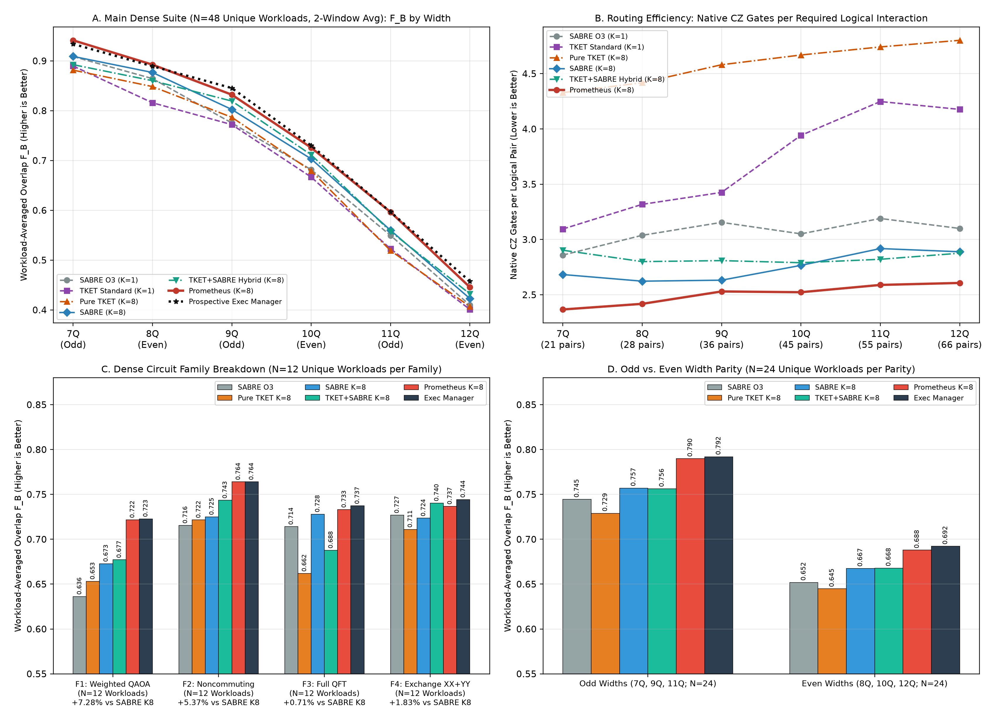

# Compilation, Spatial Packing & Quality-Gated Scheduling on IQM Hardware

*Portfolio Hub: [Prometheus Quantum Overview](https://github.com/PrometheusDynamicsCanada/prometheus-quantum-overview) · [338-Job IQM / 867-Record Portfolio Ledger](https://github.com/PrometheusDynamicsCanada/prometheus-quantum-overview/blob/main/PORTFOLIO_ACCOUNTING_LEDGER.json) · [Detailed Technical Report](DETAILED_TECHNICAL_REPORT.md) · [Public Disclosure](PUBLIC_DISCLOSURE.md)*

## Executive Summary (`54Q` `IQM Emerald` & `20Q` `IQM Garnet`, `59` Jobs, `1,479` PUBs, `1,935` Evaluations, `1,135,616` Shots)

*Scope note:* This repository contains `59` live IQM Resonance hardware jobs (`19` dense-compilation jobs `01a1a579..`..`01a1a5a8..` and `40` spatial-packing/scheduler jobs `01a19ff2..`..`01a1a47b..`), which form one component of the `338` unique IQM Resonance jobs reconciled across all `14` repositories in [`PORTFOLIO_ACCOUNTING_LEDGER.json`](https://github.com/PrometheusDynamicsCanada/prometheus-quantum-overview/blob/main/PORTFOLIO_ACCOUNTING_LEDGER.json). The three evaluated capabilities - **(1) non-local circuit compilation**, **(2) small-circuit `4-way` spatial packing**, and **(3) quality-gated packing scheduling** - are reported separately below alongside their matched baseline controls:

| Capability & Experimental Arm | Scope (`Workloads` / `Evals`) | Output-Distribution Agreement $F_B$ `*(mean / med)*` `(↑)` | Squared Hellinger $F_H$ `*(mean)*` `(↑)` | `TVD` `*(mean)*` `(↓)` | `CZ` Gates / `2Q` Depth `*(mean)*` `(↓)` | Billed Credits & Qualifying Yield (`F_B >= 0.90` on `4Q-5Q`) |
| :--- | :---: | :---: | :---: | :---: | :---: | :--- |
| **1. Compilation (`7Q-12Q` Dense): TKET `K=8`** | `48` wklds / `96` evals | `0.6869` / `0.7275` | `0.5035` | `0.5453` | `251.04` / `127.42` | `2 / 48` pairwise wins vs. Prom |
| **1. Compilation (`7Q-12Q` Dense): SABRE `K=8`** | `48` wklds / `96` evals | `0.7123` / `0.7441` | `0.5385` | `0.5126` | `152.08` / `81.58` | `9 / 48` pairwise wins vs. Prom |
| **1. Compilation (`7Q-12Q` Dense): Prom `K=8`** | `48` wklds / `96` evals | **`0.7389` / `0.7919`** | **`0.5766`** | **`0.4766`** | **`139.42` / `54.42`** | **`+3.73%` vs. SABRE (`39/48`) · `+7.57%` vs. TKET (`46/48`)** |
| **1. Compilation (`13Q-17Q` Dense): SABRE `K=8`** | `12` wklds / `18` evals | `0.1849` / `0.1808` | `0.0413` | `0.9407` | `430.00` / `181.75` | `0 / 12` wins vs. Prom (noise-limited regime) |
| **1. Compilation (`13Q-17Q` Dense): Prom `K=8`** | `12` wklds / `18` evals | **`0.2022` / `0.1963`** | **`0.0503`** | **`0.9285`** | **`364.17` / `71.67`** | **`+9.37%` vs. SABRE (`12/12` wins, `-60.6%` `2Q` depth)** |
| **2. Packing (`4Q-5Q`): SABRE `1-Way` Separate** | `60` wklds x `2` win (`120` PUBs) | `0.9662` / `0.9757` | `0.9343` | `0.1770` | `21.45` / `55.72` | `22.50 cr` (`116/120` pass, `5.16` qual/cr) |
| **2. Packing (`4Q-5Q`): Prom `1-Way` Separate** | `60` wklds x `2` win (`120` PUBs) | **`0.9754` / `0.9805`** | **`0.9518`** | **`0.1502`** | **`20.48` / `49.62`** | `22.50 cr` (**`120/120` pass**, `5.33` qual/cr, `p = 0.00092`) |
| **2. Packing (`4Q-5Q`): TKET `4-Way` Packed** | `60` wklds x `2` win (`30` PUBs) | `0.9632` / `0.9702` | `0.9284` | `0.1881` | `23.63` / `59.98` | **`7.50 cr`** (`118/120` pass, `15.73` qual/cr) |
| **2. Packing (`4Q-5Q`): SABRE `4-Way` Packed** | `60` wklds x `2` win (`30` PUBs) | `0.9699` / `0.9753` | `0.9412` | `0.1668` | `21.42` / `51.23` | `8.25 cr` (**`120/120` pass**, `14.55` qual/cr) |
| **2. Packing (`4Q-5Q`): Prom `4-Way` Packed** | `60` wklds x `2` win (`30` PUBs) | `0.9705` / `0.9778` | `0.9423` | `0.1632` | **`20.48` / `49.62`** | **`7.50 cr` (`120/120` pass, `16.00` qual/cr; `-66.7%` vs. `1-Way`)** |
| **3. Stress Scheduler (`4Q-5Q`): `1-Way` Separate** | `16` wklds (`16` PUBs) | **`0.9462` / `0.9659`** | **`0.8974`** | **`0.1852`** | `27.50` / `66.00` | `3.75 cr` (`12/16` at `0.90`, `12/16` at `0.88`) |
| **3. Stress Scheduler (`4Q-5Q`): Blind `4-Way`** | `16` wklds (`4` PUBs) | `0.9078` / `0.9434` | `0.8292` | `0.2803` | `27.50` / `66.00` | **`1.50 cr`** (`12/16` at `0.90`, `12/16` at `0.88`, `8.00` qual/cr) |
| **3. Stress Scheduler (`4Q-5Q`): Prom Scheduler** | `16` wklds (`12` PUBs) | `0.9458` / `0.9620` | `0.8964` | `0.1995` | `27.50` / `66.00` | `3.00 cr` (`12/16` at `0.90`, **`14/16` at `0.88`**, `99.0%` drop recovery) |

*Metric Key:* Output-distribution agreement is Classical Bhattacharyya Overlap $F_B = \sum_x \sqrt{P_{\text{ideal}}(x)P_{\text{meas}}(x)}$ (which legacy Studio UI screenshots label `"State Fidelity"`, distinct from $4^n$ quantum state tomography); Squared Hellinger Fidelity is $F_H = F_B^2$. `(↑)` higher is better, `(↓)` lower is better; **bold** marks within-study winners. Note that in Capability `2` and `3`, structural `CZ` / depth columns report full-circuit `CZ` count and total circuit depth across the `4Q-5Q` suite, whereas Capability `1` reports `CZ` count and `2Q`-gate depth across the `7Q-17Q` dense suite.

---

## Three Distinct Capabilities & Measured Boundaries

1. **Non-Local Compilation on Square-Lattice Hardware (`7Q-17Q`, `19` Jobs, `739` PUBs):**
   - **Equal-budget `K=8` comparison (`48` unique `7Q-12Q` workloads):** Giving Prometheus, SABRE, and TKET an `8`-candidate search budget (`K=8`, matched candidate count rather than matched classical wall-clock time), Prometheus raised mean output-distribution agreement to **`0.7389`** vs. **`0.7123`** for `SABRE K=8` (**`+3.73%`**, `39/48` wins) and **`0.6869`** for `TKET K=8` (**`+7.57%`**, `46/48` wins). Gains were workload-dependent: weighted complete-graph `QAOA` cut MaxCut expectation error by **`-19.1%`** (`+7.28%` $F_B$, `p = 0.00146`), whereas phase-sensitive `QFT` differed from `SABRE K=8` by `+0.71%` (`p = 0.3804`, no statistically significant difference detected).
   - **Matched initial qubit subgraphs (`16` workloads):** Fixing identical physical qubit sets isolated routing and gate synthesis from placement, where Prometheus beat both `SABRE K=8` (`+5.40%`) and `TKET K=8` (`+7.60%`) on **`16/16` workloads**.
   - **Boundaries (`0`-SWAP chains & `13Q-17Q` noise limit):** On `6` sparse 1D chain controls requiring `0` routing SWAPs (`SABRE K=8` `0.8982` vs. Prometheus `0.8877`, `-1.16%`), no statistically significant difference was detected (`p = 0.4375`). At `13Q-17Q` (`12` dense workloads), Prometheus won `12/12` comparisons vs. `SABRE K=8` (`+9.37%`, `-60.6%` `2Q` depth), but absolute agreement (`0.2022`) reflects decoherence limits rather than standalone application accuracy.

2. **Buffered `4-Way` Spatial Packing on Small Circuits (`4Q-5Q`, `13` Stage 2 Jobs, `60` Workloads x `2` Windows = `120` Evaluations):**
   - **Packing vs. separate execution:** Running four `4Q-5Q` circuits simultaneously on buffered `IQM Emerald` regions reduced billed credits by **`66.7%`** (`7.50` vs. `22.50` credits), yielding **`3.00x`** qualifying evaluations per credit against unpacked `Prometheus 1-Way` (`120/120` at `F_B >= 0.90`, `16.00` vs. `5.33` qual/credit) and **`3.10x`** against unpacked `SABRE 1-Way` (`116/120` at `22.50` credits, `5.16` qual/credit).
   - **Comparison against equally `4-way`-packed baselines:** The threefold throughput gain is primarily the benefit of `4-way` spatial packing over `1-way` execution. Against equally `4-way`-packed baselines across the same two windows, `Prometheus 4-Way` (`120/120` qualifying at `7.50` credits, mean $F_B = 0.9705$) used **`-9.1%` fewer credits** than `SABRE 4-Way` (`120/120` at `8.25` credits, $F_B = 0.9699$) and passed **`120/120` vs. `118/120`** at identical `7.50` credits compared with `TKET 4-Way` ($F_B = 0.9632$).

3. **Quality-Gated Packing Scheduler (`4Q-5Q`, `15` Stage 3-4 Jobs):**
   - **Mechanism & trade-off:** Stage 3 delay controls showed that `~78.1%` of `4-way` overlap loss on `5Q` Trotter rings came from waiting for longer co-scheduled circuits (`-0.0207` of `-0.0265` $\Delta F_B$). In the `16`-workload Stage 4B stress suite, blind `4-way` packing cost `1.50` credits (`0.9078` mean $F_B$) vs. `3.75` credits for `1-way` (`0.9462`). The prospective `Prometheus Scheduler` (`3.00` credits, `0.9458` mean $F_B$) recovered **`99.0%` of the packing-induced overlap drop** (`0.0379` of `0.0384`), demonstrating a controlled quality-versus-credit trade-off (`14/16` vs. `12/16` passing at `F_B >= 0.88`, and `12/16` across all three policies at `F_B >= 0.90`).

*Summary figure: `4-way` spatial packing on `54Q` `IQM Emerald` (`-66.7%` credits vs. `1-way` execution) and Stage 4B prospective scheduler trade-off (`99.0%` recovery of blind-packing overlap loss at `3.00` vs. `3.75` `1-way` credits).*

---

## Inspect the Evidence & Reproduce Supported Checks Offline

- **What can and cannot be reproduced publicly:** Per [`PUBLIC_DISCLOSURE.md`](PUBLIC_DISCLOSURE.md), all `1,935` raw bitstring measurement histograms (`counts`), ideal statevector reference distributions (`ideal_probs`), structural gate/depth summaries, pre-execution timestamps, and statistical hypothesis tests are published and verified offline below, whereas proprietary compiler routing code, physical qubit coordinate lists, and serialized gate schedules are withheld.
- **Command:** `python scripts/verify_iqm_resonance_ledger.py`
- **Dependencies & measured runtime:** Python 3 + `numpy` + `scipy` (`0` cloud credentials, **`~3.25 s`** measured runtime; recomputes all `1,935` evaluations across all `59` jobs, `47` bootstrap/sign-flip statistical blocks, and `34/34` file SHA-256 digests).
- **Try QuantumCompiler (`10` free jobs) or discuss a benchmark:** [prometheusdynamics.ca/quantumcompiler](https://prometheusdynamics.ca/quantumcompiler) | [william@prometheusdynamics.ca](mailto:william@prometheusdynamics.ca)

---

## Full Stage-by-Stage Controls & Scientific Figures

<strong>1. Additional Dense Compilation Controls (`K=1`, Hybrid Prepass, Shared Subgraphs & Sparse Chains) - Click to expand</strong>

- **Default `K=1` & Hybrid Baselines (`7Q-12Q`, `48` workloads):** `P1_SABRE_O3_Fixed` $F_B = 0.6982 / 0.7178$ (`+5.83%` Prom lead, `43W/4L/1T`); `P2_TKET_Standard` $F_B = 0.6780 / 0.7058$ (`+8.98%` Prom lead, **`48/48` wins**); `P4_TKET_Preproc_SABRE_K8` $F_B = 0.7121 / 0.7673$ (`+3.76%` Prom lead, `39/48` wins).
- **Stage 3 Identical Initial Subgraph (`16` workloads, `01a1a5a1, 01a1a5a2, 01a1a5a8`):** Prom **`0.7222 / 0.7341`** vs. `SABRE K=8` `0.6852 / 0.6883` (**`+5.40%`, `16/16` wins**) & `TKET K=8` `0.6712 / 0.6865` (**`+7.60%`, `16/16` wins**).
- **Stage 3 Sparse 1D Chain Control (`6` workloads, `0` SWAPs):** `SABRE K=8` `0.8982` vs. Prom `0.8877` (`-1.16%`, `p = 0.4375`, no statistically significant difference detected).
- **Stage 4A Standard Held-Out Scheduler (`32` workloads):** `Prom Scheduler` `0.9785` (`3.75 cr`, `8.53` qual/cr, min workload $F_B = 0.9501$) vs. `Always 1-Way` `0.9789` (`6.75 cr`, `4.74` qual/cr) and `Always 4-Way` `0.9774` (`3.00 cr`, `10.67` qual/cr).

<strong>2. Additional Multi-Panel Dense & Parallel Figures - Click to expand</strong>

