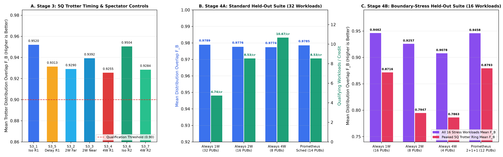
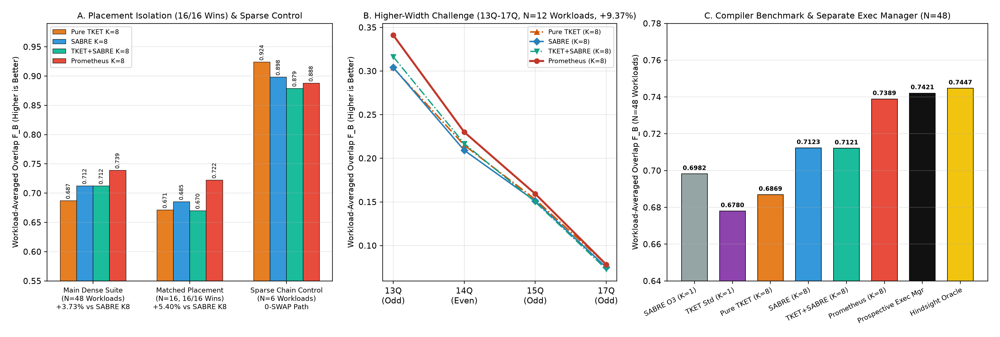

# Parallel Execution and Dense-Circuit Compilation on IQM Hardware

*Explore the portfolio: [Prometheus Quantum Overview](https://github.com/PrometheusDynamicsCanada/prometheus-quantum-overview)*

**We tested how packing calculations together and improving their compilation affected useful output and hardware charges on IQM processors.**

Square-lattice IQM processors pose two distinct execution challenges - unused chip capacity on small jobs and routing overhead on wider non-local circuits - evaluated here as two separate hardware studies alongside Qiskit SABRE and Quantinuum TKET:

- **Study 1 - Simultaneous Multi-Circuit Execution (`4-5` qubits):** Four-way simultaneous execution on IQM Emerald retained `120/120` passing circuits at `F_B >= 0.90` and delivered **`3.00x` qualifying results per charged IQM credit** (`7.50` vs. `22.50` credits), while a frozen pre-registered scheduling policy recovered `99.0%` of co-scheduled degradation on heterogeneous workloads.
- **Study 2 - Dense-Circuit Compilation (`7-17` qubits):** On non-local circuits on `IQM Emerald`, Prometheus improved mean output agreement by **`+3.73%` over equal-budget SABRE (`39/48` wins)** and **`+7.57%` over TKET (`46/48` wins)** at `7-12` qubits (`+9.37%` and `12/12` wins vs. SABRE at `13-17` qubits), while matching baselines on simple 1D chains that required no routing detours.

**[Detailed results](DETAILED_TECHNICAL_REPORT.md) · [Verify the evidence](#verify-the-evidence) · [Discuss a pilot](#discuss-a-pilot)**


*Opening summary (`Study 1` on `54Q` `IQM Emerald`): Four-way simultaneous execution retained `120/120` passing circuits (`3.00x` qualifying workloads per IQM credit), while a frozen pre-registered scheduling policy recovered `99.0%` of co-scheduled degradation on heterogeneous workloads.*

---

## 1. Executive Summary & Principal Comparative Benchmarks

*Campaign Scope:* `59` live IQM Resonance jobs (`40` parallel-execution + `19` dense-compilation), `1,479` physical PUBs, `1,935` workload evaluations, and `1,135,616` physical shots across 54-qubit `IQM Emerald` and 20-qubit `IQM Garnet`.

> [!NOTE]
> **Metric & Statistical Conventions:**
> - **Classical Bhattacharyya Overlap (F_B (↑)):** F_B = Σ_x √(P_ideal(x) · P_meas(x)) (often labeled `"State Fidelity"` in Studio UIs).
> - **Squared Hellinger Fidelity (F_H (↑)):** F_H = F_B². **Total Variation Distance (TVD (↓)):** 0.5 · Σ_x |P_ideal(x) - P_meas(x)|.
> - **Primary Statistical Unit:** For multi-window dense-circuit comparisons, repeated windows within each workload are averaged first so **unique logical workloads (N = 48, 16, 6, 12)** serve as the independent unit for paired Wilcoxon and Holm-Bonferroni tests. For spatial multiplexing, 4-workload co-scheduled groups (N = 15, 8, 4) serve as the primary cluster unit. Winning values in each comparison row/group are **bolded**.

### Table 1A: Dense-Circuit Optimization & Matched Physical Placement (IQM Emerald 54Q, 19 Jobs, 739 Circuits, 756,736 Shots)

| Stage & Compiler Pipeline | IQM Job IDs (1,024 Shots/Circ) | Scope (Workloads / Evals / Shots) | Compiled CZ Gates *(mean / med)* (↓) | CZ / Pair *(mean)* (↓) | 2Q Depth *(mean / med)* (↓) | Overlap F_B *(mean / med)* (↑) | Hellinger F_H *(mean / med)* (↑) | TVD *(mean / med)* (↓) | % Delta F_B (`P5` vs. Row) & Paired Wilcoxon p (Unadj / Holm) |
| :--- | :--- | :---: | :---: | :---: | :---: | :---: | :---: | :---: | :--- |
| **Stage 2 (7Q-12Q):** `P1_SABRE_O3_Fixed` (K=1) | `01a1a598..01a1a5a0` (10 Jobs) | 48 Wk / 87 Ev / 89,088 | 170.62 / 145.5 | 3.065 | 102.58 / 94.0 | 0.6982 / 0.7178 | 0.5199 / 0.5153 | 0.5275 / 0.5230 | **+5.83%** (p = 4.49 × 10⁻¹⁰ / 1.35 × 10⁻⁹, 43W/4L/1T) |
| **Stage 2 (7Q-12Q):** `P2_TKET_Standard_Routed` (K=1) | `01a1a598..01a1a5a0` (10 Jobs) | 48 Wk / 81 Ev / 82,944 | 209.88 / 187.5 | 3.701 | 128.73 / 105.5 | 0.6780 / 0.7058 | 0.4901 / 0.4982 | 0.5545 / 0.5453 | **+8.98%** (p = 7.11 × 10⁻¹⁵ / 3.55 × 10⁻¹⁴, **48/48 Wins**) |
| **Stage 2 (7Q-12Q):** `P2b_TKET_Pure_Routed_K8` (K=8) | `01a1a598..01a1a5a7` (11 Jobs) | 48 Wk / 96 Ev / 98,304 | 251.04 / 227.5 | 4.590 | 127.42 / 99.0 | 0.6869 / 0.7275 | 0.5035 / 0.5294 | 0.5453 / 0.5251 | **+7.57%** (p = 4.97 × 10⁻¹⁴ / 1.99 × 10⁻¹³, **46/48 Wins**) |
| **Stage 2 (7Q-12Q):** `P3_SABRE_K8` (K=8) | `01a1a598..01a1a5a7` (11 Jobs) | 48 Wk / 96 Ev / 98,304 | 152.08 / 137.5 | 2.752 | 81.58 / 80.0 | 0.7123 / 0.7441 | 0.5385 / 0.5537 | 0.5126 / 0.5008 | **+3.73%** (p = 2.73 × 10⁻⁸ / 5.47 × 10⁻⁸, **39/48 Wins**) |
| **Stage 2 (7Q-12Q):** `P4_TKET_Preproc_SABRE_K8` (K=8) | `01a1a598..01a1a5a7` (11 Jobs) | 48 Wk / 63 Ev / 64,512 | 156.00 / 131.5 | 2.833 | 89.54 / 74.0 | 0.7121 / 0.7673 | 0.5369 / 0.5889 | 0.5170 / 0.5007 | **+3.76%** (p = 8.80 × 10⁻⁶ / 8.80 × 10⁻⁶, **39/48 Wins**) |
| **Stage 2 (7Q-12Q):** **`P5_Prometheus_K8` (K=8)** | `01a1a598..01a1a5a7` (11 Jobs) | 48 Wk / 96 Ev / 98,304 | **139.42 / 123.0** | **2.506** | **54.42 / 52.0** | **0.7389 / 0.7919** | **0.5766 / 0.6275** | **0.4766 / 0.4423** | **Reference Primary** (**-8.3% CZ, -33.3% 2Q Depth vs. SABRE K8**) |
| **Stage 3 Matched Layout:** `P2b_TKET_Pure_Routed_K8` | `01a1a5a1, 01a1a5a2, 01a1a5a8` | 16 Wk / 32 Ev / 32,768 | 253.38 / 235.5 | 4.553 | 125.75 / 95.0 | 0.6712 / 0.6865 | 0.4924 / 0.4846 | 0.5540 / 0.5611 | **+7.60%** (p = 3.05 × 10⁻⁵, **16/16 Wins = 100%**) |
| **Stage 3 Matched Layout:** `P3_SABRE_K8` | `01a1a5a1, 01a1a5a2, 01a1a5a8` | 16 Wk / 32 Ev / 32,768 | 159.88 / 155.5 | 2.860 | 85.38 / 83.0 | 0.6852 / 0.6883 | 0.5133 / 0.4820 | 0.5294 / 0.5680 | **+5.40%** (p = 3.05 × 10⁻⁵, **16/16 Wins = 100%**) |
| **Stage 3 Matched Layout:** **`P5_Prometheus_K8`** | `01a1a5a1, 01a1a5a2, 01a1a5a8` | 16 Wk / 32 Ev / 32,768 | **144.88 / 121.5** | **2.575** | **46.81 / 41.0** | **0.7222 / 0.7341** | **0.5628 / 0.5549** | **0.4820 / 0.4980** | **Identical Initial Subgraph: -9.4% CZ, -45.2% 2Q Depth vs. SABRE K8** |
| **Stage 3 Sparse 1D Control:** `P3_SABRE_K8` vs. `P5` | `01a1a5a1, 01a1a5a2` (2 Jobs) | 6 Wk / 6 Ev/Arm / 24,576 | 34.00 / 34.0 | 2.000 | 21.00 / 21.0 | 0.8982 vs. 0.8877 | 0.8104 vs. 0.7918 | 0.2944 vs. 0.3231 | -1.16% (p = 0.4375; 0 SWAPs needed, no significant diff.) |
| **Stage 4 High-Width (13Q-17Q):** `P2b_TKET_Pure_K8` | `01a1a5a3, 01a1a5a4` (2 Jobs) | 12 Wk / 18 Ev / 18,432 | 616.83 / 568.5 | 4.577 | 152.75 / 140.0 | 0.1875 / 0.1793 | 0.0421 / 0.0328 | 0.9394 / 0.9481 | **+7.83%** (p = 0.0342, **9/12 Wins = 75.0%**) |
| **Stage 4 High-Width (13Q-17Q):** `P3_SABRE_K8` | `01a1a5a3, 01a1a5a4` (2 Jobs) | 12 Wk / 18 Ev / 18,432 | 430.00 / 362.5 | 3.111 | 181.75 / 159.0 | 0.1849 / 0.1808 | 0.0413 / 0.0331 | 0.9407 / 0.9475 | **+9.37%** (p = 4.88 × 10⁻⁴, **12/12 Wins = 100%**) |
| **Stage 4 High-Width (13Q-17Q):** **`P5_Prometheus_K8`** | `01a1a5a3, 01a1a5a4` (2 Jobs) | 12 Wk / 18 Ev / 18,432 | **364.17 / 293.0** | **2.607** | **71.67 / 73.5** | **0.2022 / 0.1963** | **0.0503 / 0.0391** | **0.9285 / 0.9398** | **Reference Primary** (**-15.3% CZ, -60.6% 2Q Depth vs. SABRE K8**) |

*(Note: Stage 1 billing pilot jobs `01a1a579-983c-75f3-8236-3e15ba88145f`, `01a1a57a-6014-73af-bea6-601094b1e2ee`, and `01a1a57a-9c6b-75f2-879a-54d1dae74aaa` add 3 jobs / 18 circuits / 18,432 shots to complete the 19-job, 739-circuit, 756,736-shot dense campaign.)*




### Table 1B: Spatial Multiplexing & Prospective Held-Out Scheduler (IQM Emerald 54Q & IQM Garnet 20Q, 40 Jobs, 740 PUBs, 1,196 Evaluations)

| Campaign Stage & Experimental Arm | IQM Job ID(s) (512 Shots/PUB) | Scope (Win / Grp / Evals / PUBs / Shots) | CZ Gates \| Depth *(mean / med)* (↓) | Overlap F_B *(mean / med)* (↑) | Hellinger F_H \| TVD *(mean / med)* | Qualified (F_B ≥ 0.90) (↑) | Active s \| Credits (↓) | Qual/s \| Qual/Cr (↑) | Throughput Multiplier / Key Outcome |
| :--- | :--- | :---: | :---: | :---: | :---: | :---: | :---: | :---: | :--- |
| **Stage 2 Pooled:** Qiskit SABRE Default (1-Way) | `01a1a45e-e21c..`, `01a1a465-a1c7..` | 2W / 15G / 120 Ev (120 PUBs, 61,440) | 21.45/19.0 \| 55.72/50.0 | 0.9662 / 0.9757 | 0.9343/0.9519 \| 0.1770/0.1590 | 116/120 (96.7%) | 27.054s \| 22.50 | 4.29 \| 5.16 | 1.00x Active s / 1.00x Credit Baseline |
| **Stage 2 Win A:** Quantinuum TKET Default (1-Way) | `01a1a462-c1ac-75ef-a2ec-25d1065089a2` | 1W / 15G / 60 Ev (60 PUBs, 30,720) | 22.50/20.0 \| 60.40/50.5 | 0.9571 / 0.9667 | 0.9168/0.9345 \| 0.2059/0.1990 | 57/60 (95.0%) | 13.861s \| 11.25 | 4.11 \| 5.07 | 0.96x Active s / 0.98x Credit vs. SABRE 1W |
| **Stage 2 Pooled:** **Prometheus Simultaneous (1-Way)** | `01a1a463-28b7..`, `01a1a465-3a4d..` | 2W / 15G / 120 Ev (120 PUBs, 61,440) | **20.48/18.0 \| 49.62/45.0** | **0.9754 / 0.9805** | **0.9518/0.9613 \| 0.1502/0.1400** | **120/120 (100%)** | 27.570s \| 22.50 | 4.35 \| 5.33 | **+0.0093 F_B vs. SABRE 1W (p = 0.00092)** |
| **Stage 2 Pooled:** **Prometheus Simultaneous (2-Way)** | `01a1a463-8f57..`, `01a1a464-f0f9..` | 2W / 15G / 120 Ev (60 PUBs, 30,720) | **20.48/18.0 \| 49.62/45.0** | 0.9741 / 0.9789 | 0.9491/0.9582 \| 0.1523/0.1461 | **120/120 (100%)** | 14.811s \| 13.50 | 8.10 \| 8.89 | **1.86x vs. Prom 1W / 1.89x vs. SABRE 1W** |
| **Stage 2 Pooled:** **Prometheus Simultaneous (4-Way)** | `01a1a463-d9a1..`, `01a1a464-a9fe..` | 2W / 15G / 120 Ev (30 PUBs, 15,360) | **20.48/18.0 \| 49.62/45.0** | 0.9705 / 0.9778 | 0.9423/0.9562 \| 0.1632/0.1528 | **120/120 (100%)** | 8.358s \| **7.50** | 14.36 \| **16.00** | **3.30x Active s (3.00x Cr) vs. Prom 1W** |
| **Stage 2 Pooled:** Qiskit SABRE + Prom Regions (4-Way) | `01a1a464-2038..`, `01a1a466-065f..` | 2W / 15G / 120 Ev (30 PUBs, 15,360) | 21.42/19.0 \| 51.23/47.5 | 0.9699 / 0.9753 | 0.9412/0.9512 \| 0.1668/0.1546 | **120/120 (100%)** | 8.291s \| 8.25 | **14.47** \| 14.55 | **3.38x Active s (2.82x Cr) vs. SABRE 1W** |
| **Stage 2 Pooled:** TKET + Prom Regions (4-Way) | `01a1a464-653c..`, `01a1a466-3e5b..` | 2W / 15G / 120 Ev (30 PUBs, 15,360) | 23.63/21.0 \| 59.98/52.0 | 0.9632 / 0.9702 | 0.9284/0.9412 \| 0.1881/0.1749 | 118/120 (98.3%) | **8.272s \| 7.50** | 14.26 \| 15.73 | **3.47x Active s (3.11x Cr) vs. TKET 1W** |
| **Stage 3 Mechanism:** 5Q Trotter Isolated on `R1` (`S3_1`) | `01a1a46b-4fce-71da-a6aa-1864fa68dc66` | 4 Targets x 2 (8 PUBs, 4,096) | 16.00/16.0 \| 40.50/38.0 | **0.9520 / 0.9748** | **0.9083/0.9503 \| 0.1695/0.1485** | 6/8 (75.0%) | 2.134s \| 2.25 | 2.81 \| 2.67 | Baseline Isolated `R1` (0 Spectators) |
| **Stage 3 Mechanism:** Schedule-Delay Control (`S3_5`) | `01a1a46c-05b5-75e1-8be0-9799eb6ade69` | 4 Targets x 2 (8 PUBs, 4,096) | 16.00/16.0 \| 41.50/39.0 | 0.9313 / 0.9551 | 0.8697/0.9121 \| 0.2230/0.2139 | 6/8 (75.0%) | 2.145s \| 2.25 | 2.80 \| 2.67 | **Reproduces 78.1% (-0.0207) of 4W Drop** |
| **Stage 3 Mechanism:** 4-Way Disjoint Spectators (`S3_4`) | `01a1a475-b266-7063-bb97-cf45095e9f7e` | 4 Targets x 2 (8 PUBs, 4,096) | 16.00/16.0 \| 40.50/38.0 | 0.9255 / 0.9506 | 0.8591/0.9036 \| 0.2361/0.2257 | 6/8 (75.0%) | 2.562s \| 2.25 | 2.34 \| 2.67 | Total 4W Drop: -0.0265 (-0.0058 Residual) |
| **Stage 4A Held-Out (32 Wk):** Always 1-Way Isolated | `01a1a470-3a80-72fc-89f4-53277235a449` | 8G / 32 Ev (32 PUBs, 16,384) | 20.22/18.0 \| 49.03/44.5 | **0.9789 / 0.9820** | **0.9584/0.9643 \| 0.1381/0.1313** | **32/32 (100%)** | 7.780s \| 6.75 | 4.11 \| 4.74 | 1.00x Baseline (Min F_B = 0.9445) |
| **Stage 4A Held-Out (32 Wk):** Always 4-Way Packed | `01a1a470-b791-70cf-ada9-a92f0bf3ee9e` | 8G / 32 Ev (8 PUBs, 4,096) | 20.22/18.0 \| 49.03/44.5 | 0.9774 / 0.9790 | 0.9554/0.9585 \| 0.1448/0.1396 | **32/32 (100%)** | **2.489s \| 3.00** | **12.85 \| 10.67** | **3.13x Active s / 2.25x Cr (Min = 0.9466)** |
| **Stage 4A Held-Out (32 Wk):** **Prometheus Scheduler** | `01a1a470-e550-7053-80ff-c1964adb3d55` | 8G / 32 Ev (14 PUBs, 7,168) | 20.22/18.0 \| 49.03/44.5 | 0.9785 / 0.9784 | 0.9575/0.9573 \| 0.1432/0.1461 | **32/32 (100%)** | 3.957s \| 3.75 | 8.09 \| 8.53 | **1.97x Active s / 1.80x Cr (Min = 0.9501)** |
| **Stage 4B Stress (16 Wk):** Always 1-Way Isolated | `01a1a47a-c61b-7276-95ea-85d2e37e6a51` | 4G / 16 Ev (16 PUBs, 8,192) | 29.00/28.5 \| 72.00/77.0 | **0.9462 / 0.9659** | **0.8974/0.9330 \| 0.1852/0.1908** | 12/16 (12/16 ≥ 0.88) | 4.271s \| 3.75 | 2.81 \| 3.20 | 1.00x (Trotter Ring Mean F_B = 0.8716) |
| **Stage 4B Stress (16 Wk):** Always 4-Way Packed | `01a1a47b-230c-73d9-9802-e5a410715b13` | 4G / 16 Ev (4 PUBs, 2,048) | 29.00/28.5 \| 72.00/77.0 | 0.9078 / 0.9434 | 0.8292/0.8899 \| 0.2803/0.2540 | 12/16 (12/16 ≥ 0.88) | **1.632s \| 1.50** | **7.35 \| 8.00** | 2.62x Active s (Trotter Ring Drops to 0.7863) |
| **Stage 4B Stress (16 Wk):** **Prometheus Scheduler** | `01a1a47b-4cb2-7449-96f1-7ff09fb07459` | 4G / 16 Ev (12 PUBs, 6,144) | 29.00/28.5 \| 72.00/77.0 | 0.9458 / 0.9620 | 0.8964/0.9255 \| 0.1995/0.1955 | 12/16 (**14/16 ≥ 0.88**) | 3.523s \| 3.00 | 3.41 \| 4.00 | **99.0% Loss Recovery (+0.0379 vs. 4W)** |
| **Initial Feasibility:** Garnet 20Q 2-Way (`T4` vs. `T3`) | `01a19ff2-ea9b..` vs. `01a19ff2-d6c8..` | 4 Pairs / 8 Ev (4 vs. 8 PUBs, 6,144) | 16.25/16.5 \| 31.63/31.5 | 0.9630 / 0.9798 | 0.9287/0.9600 \| 0.1542/0.1430 | 7/8 (87.5%) | 1.103s \| 1.00 | 6.35 \| 7.00 | **1.47x Active s vs. Matched 1W (`T3` = 0.9676)** |
| **Initial Feasibility:** Emerald 54Q 2-Way (`E_T3` vs. `E_T2`) | `01a19ff3-9372..` vs. `01a19ff3-7389..` | 4 Pairs / 8 Ev (4 vs. 8 PUBs, 6,144) | 18.88/16.0 \| 36.13/32.0 | 0.9738 / 0.9840 | 0.9490/0.9683 \| 0.1325/0.1387 | **8/8 (100%)** | 2.103s \| 3.75 | 3.80 \| 2.13 | **1.57x Active s / 1.20x Cr vs. Matched 1W** |


---

## Verify the Evidence

**Verification Kind:** Direct **raw-measurement histogram reconstruction** across all `59` IQM Resonance jobs (`1,935` workload evaluations across `54Q` `IQM Emerald` and `20Q` `IQM Garnet`, zero cloud credentials required):

```bash
python scripts/verify_iqm_resonance_ledger.py
```

- **Key files:** [`DETAILED_TECHNICAL_REPORT.md`](DETAILED_TECHNICAL_REPORT.md) · [`data/dense_campaign_stages2_3_4_results.json`](data/dense_campaign_stages2_3_4_results.json) · [`data/stage2_emerald_replication_results.json`](data/stage2_emerald_replication_results.json) · [`PUBLIC_DISCLOSURE.md`](PUBLIC_DISCLOSURE.md) · [`REPO_SHA256_MANIFEST.json`](REPO_SHA256_MANIFEST.json)

---

## Discuss a Pilot

**Bring a representative workload and an acceptance criterion. We can compare Prometheus with your existing execution approach and measure quality, acceptance rate and charged hardware resources.**

- **Contact:** [william@prometheusdynamics.ca](mailto:william@prometheusdynamics.ca) | [prometheusdynamics.ca](https://prometheusdynamics.ca)
