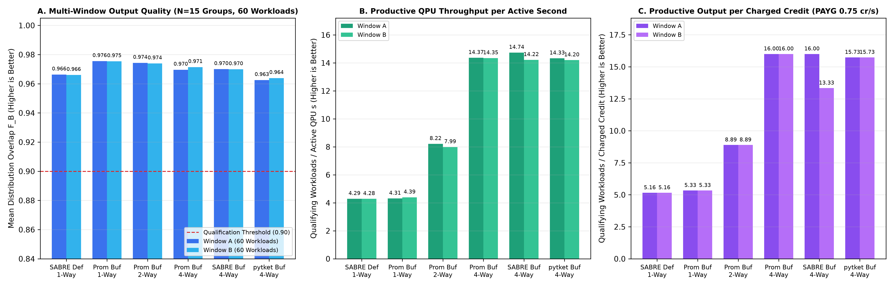

# Parallel Execution & Dense Compilation on IQM Hardware

*Portfolio Hub: [Prometheus Quantum Overview](https://github.com/PrometheusDynamicsCanada/prometheus-quantum-overview) · [Detailed Technical Report](DETAILED_TECHNICAL_REPORT.md) · [Public Disclosure](PUBLIC_DISCLOSURE.md)*

**Across 59 live IQM Resonance jobs, Prometheus delivered 3.00x qualifying workloads per IQM credit on packed small circuits and up to +9.37% higher overlap on wider non-local circuits.**

## At a Glance

- **Study 1 - 4-Way Parallel Execution (`4Q-5Q`, `40` jobs):** Retained **`120/120` passing circuits (`F_B >= 0.90`)** at **`3.00x` qualifying workloads per IQM credit** (`7.50` vs. `22.50` credits), recovering `99.0%` of co-scheduling loss under stress.
- **Study 2 - Dense Compilation (`7Q-17Q`, `19` jobs):** Improved output overlap by **`+3.73%` (`39/48` wins)** vs. equal-budget `SABRE K=8` and **`+7.57%` (`46/48` wins)** vs. `TKET K=8` at `7Q-12Q`, rising to **`+9.37%` (`12/12` wins)** vs. SABRE at `13Q-17Q`.
- **Matched-layout & 1D controls:** Won **`16/16` (`100%`)** on identical initial chip subgraphs (`-45.2%` `2Q` depth) and matched SABRE on trivial 1D chains (`0` SWAPs needed).
- **Hardware scope:** `59` jobs, `1,479` PUBs, `1,935` evaluations, and `1,135,616` physical shots on `54Q` `IQM Emerald` and `20Q` `IQM Garnet`.

*4-way simultaneous execution on 54Q IQM Emerald (`3.00x` qualifying/credit) and held-out prospective scheduler recovery (`99.0%`).*

---

## Executive Summary (`54Q` `IQM Emerald` Headline Stages, `59` Total Jobs, `1,135,616` Shots)

*Hardware IDs:* Parallel `01a19ff2..`..`01a1a47b..` (`40` jobs); Dense `01a1a579..`..`01a1a5a8..` (`19` jobs).

| Study & Experimental Arm | Scope (`Evals`) | Overlap $F_B$ `*(mean / med)*` `(↑)` | Hellinger $F_H$ `*(mean)*` `(↑)` | `TVD` `*(mean)*` `(↓)` | `CZ` Gates / Depth `*(mean)*` `(↓)` | Credits / Yield Outcome |
| :--- | :---: | :---: | :---: | :---: | :---: | :--- |
| **Study 1 (`4Q-5Q`): SABRE `1-Way`** | `120` (`120` PUBs) | `0.9662` / `0.9757` | `0.9343` | `0.1770` | `21.45` / `55.72` | `22.50 cr` (`116/120` pass, `1.00x`) |
| **Study 1 (`4Q-5Q`): Prom `1-Way`** | `120` (`120` PUBs) | **`0.9754` / `0.9805`** | **`0.9518`** | **`0.1502`** | **`20.48` / `49.62`** | `22.50 cr` (**`120/120` pass**, `p = 0.00092`) |
| **Study 1 (`4Q-5Q`): Prom `4-Way` Packed** | `120` (**`30` PUBs**) | `0.9705` / `0.9778` | `0.9423` | `0.1632` | **`20.48` / `49.62`** | **`7.50 cr` (`120/120`, `3.00x` / credit)** |
| **Study 2 (`7Q-12Q` Dense): TKET `K=8`** | `96` (`48` wklds) | `0.6869` / `0.7275` | `0.5035` | `0.5453` | `251.04` / `127.42` | `2 / 48` vs. Prom |
| **Study 2 (`7Q-12Q` Dense): SABRE `K=8`** | `96` (`48` wklds) | `0.7123` / `0.7441` | `0.5385` | `0.5126` | `152.08` / `81.58` | `9 / 48` vs. Prom |
| **Study 2 (`7Q-12Q` Dense): Prom `K=8`** | `96` (`48` wklds) | **`0.7389` / `0.7919`** | **`0.5766`** | **`0.4766`** | **`139.42` / `54.42`** | **`+3.73%` vs. S (`39/48`) · `+7.57%` vs. T (`46/48`)** |
| **Study 2 (`13Q-17Q` Dense): Prom `K=8`** | `18` (`12` wklds) | **`0.2022` / `0.1963`** | **`0.0503`** | **`0.9285`** | **`364.17` / `71.67`** | **`+9.37%` vs. SABRE (`12/12` wins, `-60.6%` depth)** |

*Metric Key:* $F_B = \sum_x \sqrt{P_{\text{ideal}}(x)P_{\text{meas}}(x)}$ (Studio `"State Fidelity"`); $F_H = F_B^2$.

- **Offline raw-histogram verifier (`59` jobs, `1,935` evaluations):** `python scripts/verify_iqm_resonance_ledger.py`
- **Start a supported pilot:** [william@prometheusdynamics.ca](mailto:william@prometheusdynamics.ca) | [prometheusdynamics.ca](https://prometheusdynamics.ca)

---

## Full Stage-by-Stage Tables & Multi-Panel Figures

<strong>1. Complete Dense Compilation Stages 2-4 & Spatial Multiplexing Stages 2-4B Tables - Click to expand</strong>

### Additional Dense Compilation Controls (`IQM Emerald`, `19` Jobs Total Incl. `3` Billing Pilot Jobs `01a1a579..01a1a57a`)
- **Default `K=1` Baselines (`7Q-12Q`, `48` workloads):** `P1_SABRE_O3_Fixed` $F_B = 0.6982 / 0.7178$ (`+5.83%` Prom lead, `43W/4L/1T`); `P2_TKET_Standard` $F_B = 0.6780 / 0.7058$ (`+8.98%` Prom lead, **`48/48` wins**); `P4_TKET_Preproc_SABRE_K8` $F_B = 0.7121 / 0.7673$ (`+3.76%` Prom lead, `39/48` wins).
- **Stage 3 Identical Initial Subgraph (`16` workloads, `01a1a5a1, 01a1a5a2, 01a1a5a8`):** Prom **`0.7222 / 0.7341`** vs. `SABRE K=8` `0.6852 / 0.6883` (**`+5.40%`, `16/16` wins**) & `TKET K=8` `0.6712 / 0.6865` (**`+7.60%`, `16/16` wins**).
- **Stage 3 Sparse 1D Chain Control (`6` workloads, `0` SWAPs):** `SABRE K=8` `0.8982` vs. Prom `0.8877` (`-1.16%`, `p = 0.4375`, no significant difference).
- **Stage 4 (`13Q-17Q`, `01a1a5a3, 01a1a5a4`):** `SABRE K=8` `0.1849 / 0.1808` (`430.0 CZ / 181.8 depth`); `TKET K=8` `0.1875 / 0.1793` (`616.8 CZ / 152.8 depth`, `9/12` Prom wins).

### Additional Spatial Multiplexing Controls (`40` Jobs Across `IQM Emerald` & `IQM Garnet`)
- **Stage 2 Hybrid Packing (`120` evals):** `TKET 1-Way` `0.9571` (`57/60` pass); `Prometheus 2-Way` `0.9741` (`120/120`, `1.86x`); `SABRE + Prom Regions 4-Way` `0.9699` (`120/120`, `2.82x/cr`); `TKET + Prom Regions 4-Way` `0.9632` (`118/120`, `3.11x/cr`).
- **Stage 3 Timing/Spectator Mechanism (`5Q` Trotter):** Isolated `0.9520` -> Schedule-delay control `0.9313` (explains `78.1%` of 4-way drop) -> 4-way spectators `0.9255`.
- **Stage 4A Held-Out (`32` workloads):** `1-Way` `0.9789` (`6.75 cr`), `Always 4-Way` `0.9774` (`3.00 cr`, `2.25x/cr`), `Prom Scheduler` `0.9785` (`3.75 cr`, `1.80x/cr`, min `F_B = 0.9501`).
- **Stage 4B Stress (`16` workloads):** `1-Way` `0.9462` (`3.75 cr`), `Always 4-Way` `0.9078` (`1.50 cr`), **`Prom Scheduler` `0.9458` (`3.00 cr`, `99.0%` loss recovery)**.
- **Initial `Garnet 20Q` & `Emerald 54Q` 2-Way Feasibility:** `1.47x` active `s` on Garnet (`01a19ff2..`) and `1.57x` active `s` (`8/8` pass) on Emerald (`01a19ff3..`).

<strong>2. Additional Multi-Panel Dense & Parallel Figures - Click to expand</strong>

